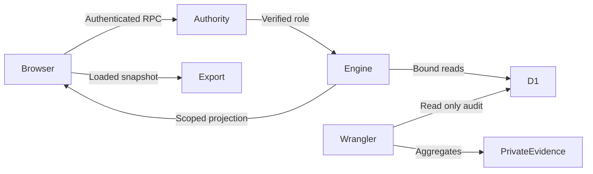

## Executive summary

The finance reporting changes must preserve cash integrity, restrict financial detail to existing finance authority, and avoid unbounded reporting work. The main risks are stale-role browser disclosure, incorrect correction classification, and repeated large authenticated reads. Controls are implemented in the report router, bounded read-only engine and browser access/cache handling. No financial mutation or new storage boundary is introduced.

## Scope and assumptions

Scope: `backend/routers.ts` financialReports, `backend/db.ts` dashboard stats/report delegation, `backend/services/financial-report-engine.ts`, shared report/CSV helpers and the two admin screens/access hook. Existing payment, expense, historical-reconciliation, owner-correction and session workflows remain authoritative and are outside the change's write scope.

The existing public Cloudflare API serves cookie-authenticated accounts. The user confirmed both admin screens, all-service defaults, Academy/Copier visibility and accuracy based on actual recorded cash. Existing owner/manager/viewer permissions are preserved; a generic administrator is not automatically a finance owner. Production audit/export is aggregate-only and read-only. External settlement is not inferred. An independently compromised database/operator or stolen authorized session would materially change the risk ranking.

## System model

### Primary components

React admin screens call protected tRPC finance procedures. Server middleware resolves current finance authority. The report engine reads approved D1 ledger entries, minimal expense metadata, bounded correction ancestry, and required historical/payment classification context. The shared scope/CSV functions consume the same integer-valued snapshot.

### Data flows and trust boundaries

- Browser → API, HTTPS/tRPC: untrusted range, viewer ID and access key; authenticated session and server-resolved finance roles govern permission, with identity/role comparison before expensive reads. Date parsing validates canonical UTC boundaries.
- API → D1, bound SQL: selected approved records and correction context; static queries, parameter binding, existing indexes and bounded rows/depth. No mutation occurs.
- API → browser: aggregate totals; only owner/manager receive the existing capped ledger projection. Viewer receives no ledger and the home summary contains no detail.
- Browser snapshot → export/print: already authorized loaded figures, applied range/scope/time; shared serialization, no new API read or external destination.
- Wrangler → ignored local evidence, operator tooling: aggregate SQL/schema only, no account identities, references or raw transaction export; excluded from deploy artifacts.

#### Diagram

## Assets and security objectives

| Asset | Why it matters | Security objective |
| --- | --- | --- |
| Ledger/cash integrity | Incorrect classification misstates recorded business performance | I |
| Financial detail | Descriptions and order references require finance access | C |
| D1/Worker capacity | Large repeated reports compete with customer traffic | A |
| Authorized browser cache | Old accounts/roles must not expose retained detail | C, I |
| Private audit evidence | Operational source metadata must remain outside public builds | C |

## Attacker model

### Capabilities

Anonymous/customer/non-finance staff can call RPCs and alter input. Finance viewers can request allowed date ranges and refresh repeatedly. An authorized owner may create incorrect or unusual corrections through existing controls. Browser sessions can change identity or lose roles while previous data remains cached.

### Non-capabilities

No assumed ability to forge a signed session, modify Worker code, bypass D1 permissions or edit approved immutable records directly. This feature neither settles payments nor connects to bank accounts.

## Entry points and attack surfaces

| Surface | How reached | Trust boundary | Notes | Evidence |
| --- | --- | --- | --- | --- |
| access | Protected RPC | Browser/API | Returns only caller's verified report role | routers.ts / financialReports.access |
| summary | Protected finance RPC | Browser/API | Strict identity/access; aggregate-only projection | routers.ts / financialReports.summary |
| dashboard | Protected finance RPC | Browser/API | Server decides ledger eligibility; optional legacy cache-key inputs cannot grant access | routers.ts / financialReports.dashboard |
| Ledger ancestry | Approved source references | D1/engine | Source ownership, sign, cycle and complete-source checks | financial-report-engine.ts / loadFinancialReport |
| Snapshot cache | Remount/account/role change | Browser identity | Identity/access key; access verification hides data and removes old scopes | useFinanceReport.ts |
| CSV/print | Explicit admin action | Browser/export | Loaded snapshot, numeric fields, known category labels | financialReportCsv.ts; AdminFinancialDashboard.tsx |
| Audit tooling | Explicit operator read | PRD/local | Ignored aggregate/schema evidence only | output/finance-dashboard-review/ |

## Top abuse paths

1. Anonymous/customer asks for finance totals → protected finance middleware rejects → no monetary response.
2. Viewer submits owner access key or another user ID → current server actor comparison rejects before loading → no ledger escalation.
3. Owner loses role while owner report is cached → access verification hides money, changes key and removes old scopes → retained owner ledger is not rendered to the new role.
4. Correction points to another order/expense or cyclic source → ancestry validation rejects complete report → no plausible-looking partial total.
5. Repeated broad report calls → indexed ranges and row/context/depth caps bound work → residual authenticated read amplification remains possible.
6. Shared reference is treated as duplicate cash → report flags without automatic deduction → legitimate repeated payments remain represented.
7. Local production evidence enters public build → ignored output and scoped artifact preparation keep audit metadata private → no customer-facing recovery/configuration content.

## Threat model table

| Threat ID | Threat source | Prerequisites | Threat action | Impact | Impacted assets | Existing controls | Gaps | Recommended mitigations | Detection ideas | Likelihood | Impact severity | Priority |
| --- | --- | --- | --- | --- | --- | --- | --- | --- | --- | --- | --- | --- |
| TM-001 | Customer/viewer | API access | Spoof identity/role or request ledger | Financial disclosure | Detail | Finance middleware; identity/access comparison; explicit projection | Future fields could drift | Keep route role/projection tests | Anonymous/role regression | low: server checks | high: sensitive detail | medium |
| TM-002 | Browser lifecycle | Previously authorized cache | Render old owner data after role change | Stale-role disclosure | Cache | Verified role key, hide during recheck, remove old scope | No instantaneous revocation push to already open browser | Recheck on focus and every report call; verify remount | Role-change browser QA | low: explicit gating | high: private detail | medium |
| TM-003 | Incorrect correction | Existing approved unusual records | Misclassify replacements/refunds as income | Misstated cash | Integrity | Source graph, ownership/sign/cycle checks; integer sums; reconciliation invariants | Cannot independently prove external cash receipt | Preserve immutable originals, surface ambiguity | Synthetic D1 source regressions | low: validation | high: financial decisions | medium |
| TM-004 | Finance reader | Authorized refresh | Repeated large ranges | Service cost/capacity | Availability | Existing auth, date-index read, source/context/depth caps; no browser polling | No new shared server report cache/rate policy | Measure real report usage before additional infrastructure | Row/query counts and indexed EXPLAIN | medium: repeated reads possible | medium: bounded workload | medium |
| TM-005 | Release operator | Private audit access | Publish local source evidence | Metadata disclosure | Audit evidence | Ignored output; feature-only release | Packaging discipline required | Verify isolated release manifest and public files | Diff/artifact checks | low: scoped workflow | medium: operational metadata | low |

## Criticality calibration

- Critical: unauthenticated financial mutation or session-signing secret disclosure; neither is introduced here.
- High: cross-role ledger disclosure or a persistent material false-cash claim.
- Medium: bounded authenticated report amplification or ambiguous refund scope without a review label.
- Low: a clearly labeled stale snapshot or a cosmetic timestamp/display defect.

## Focus paths for security review

| Path | Why it matters | Related Threat IDs |
| --- | --- | --- |
| backend/routers.ts | Current authority before report computation and response projection | TM-001 |
| backend/services/financial-report-engine.ts | Complete bounded cash calculation and lineage | TM-003, TM-004 |
| frontend/src/lib/useFinanceReport.ts; frontend/src/lib/financialReportInvalidation.ts | Identity/role gating and invalidation after cash workflows without background report reads | TM-002, TM-003 |
| frontend/src/pages/AdminFinancialDashboard.tsx | No stale-role display; explicit range/scope/time | TM-002, TM-003 |
| shared/financialReportCsv.ts | Export parity and limited fields | TM-001, TM-003 |
| output/finance-dashboard-review/ | Private tooling separated from runtime/build | TM-005 |

## Notes on use

The three report RPCs, operational stats removal, database read boundary, browser cache and export boundary are covered. Runtime and operator tooling are separated. User-confirmed cash/audience/scope choices are incorporated. Existing financial write workflows and external bank reconciliation are not silently changed. Local verification/release status is maintained in [finance-dashboard-accuracy.md](finance-dashboard-accuracy.md).
