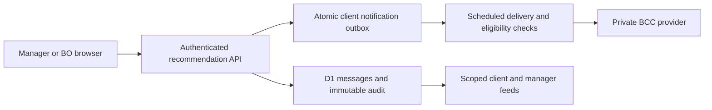

# Recommendation integrity threat model

## Scope and confirmed context

The owner confirmed a production academy system, analyst isolation, required SL/targets, no extra publishing delay, immutable published history and notifications for pending cancellation/early exit. Those confirmations resolve the service-context assumptions for this scoped review. No further approval/intake gate is required for the authorized implementation. Historical recovery, broker execution integration, infrastructure/auth redesign and production release are outside this local implementation.

Runtime: React/tRPC client, authenticated TypeScript Worker API, D1, scheduled delivery and BCC email provider. Evidence: `frontend/src/pages/AdminRecommendations.tsx`, `backend/routers.ts` recommendation router, `backend/db.ts`, `backend/services/recommendation-delivery.service.ts`, `wrangler-worker.toml`. Local test/build processes are not runtime actors.

## Assets, actors and boundaries

Integrity assets: original recommendation/SL/targets, results, correction history, cancellation state and report membership. Confidentiality assets: publisher identities, other managers' work and recipient addresses. Availability assets: existing one-minute release timing, urgent follow-up delivery and retry capacity.

An authenticated analyst controls request fields and may guess root IDs, replay requests, change free text and invoke obsolete APIs. An unauthenticated user cannot cross `protectedProcedure`; an analyst is not a full admin. Full admins have global oversight but application deletion is intentionally forbidden. Direct database owners and compromised infrastructure can remove triggers; this application control is not an independently anchored external ledger.

Boundaries: browser to API uses existing session, origin and Zod validation; actor/role come from the server. API to D1 uses bound parameters, ownership predicates and atomic batches. D1 to provider is revalidated at send time, with identical-payload BCC, dedupe, retries and hard-bounce suppression. Feed and report readers retain analyst scope and author redaction. Email acceptance crosses an external trust boundary and cannot establish reading, execution or fill price.

## Threats and controls

| Abuse path | Likelihood / impact / priority | Mitigation and evidence |
|---|---|---|
| Analyst invokes old delete/edit APIs to erase a losing result | High / high / high | Both procedures fail closed; DB helpers reject; migration 136 blocks DELETE and original-field UPDATE for all published message types. |
| Analyst guesses another root or leaks authors through a notice | Medium / high / high | Management helper conceals inaccessible roots and rechecks root ownership in INSERT SELECT. No supplied actor identity is accepted. Existing `protectRecommendationAuthors` and scoped feeds/reports remain. |
| Analyst marks an entered or losing trade cancelled to remove it from reporting | High / high / high | Explicit immutable entry mode, confirmation, open root and no-follow-up guard checked again in the transaction; cancellation remains visible and separately counted. Management prose is excluded from scoring. False declarations about market activation remain a BO-review risk without broker/market evidence. |
| Crash or queue failure leaves cancellation committed with no client notice | Medium / high / high | Message/state/outbox/in-app insertion in one D1 batch; fault-injection rollback test. Existing original audience required. Provider work happens after commit. |
| Retry produces duplicate cancellations or emails | Medium / medium / medium | Unique request UUID, event/user uniqueness and existing claim/provider lifecycle. External exactly-once delivery cannot be guaranteed after ambiguous provider responses. |
| Closed-thread/session-expiry or subscription expiry suppresses cancellation | High / high / high | Dedicated management event bypasses ordinary stale-update/orphan-result selection and current-subscription expiry. Original audience is fixed. Account/preference/permanent suppression and staff exclusion remain visible rather than weakened. |
| Manual result override silently changes monthly performance | High / high / high | Full-admin-only correction with mandatory reason and atomic before/after append-only audit. Original message content remains immutable. Human-entered milestones are still not independently verified results. |
| User text injects SQL or script into clients/email | Medium / high / high | Bound SQL, bounded reason, normal React text rendering and existing escaped email template. Synthetic HTML-escape regression. |

## Verification and remaining limits

Tests exercise real local D1 batch behavior, legacy-preserving migration, cross-owner denial, immutable results, rollback, duplicate retry, audience restriction and escaping. Production-shaped rehearsal also checks management notices survive stale reconciliation, send-time expiry handling, scoped feeds and result audit. Exact local plans and parameter counts are retained privately. These are not live-schema migration plans: production still needs the documented migration/release gates.

No automatic market-price/SL watcher or client broker integration is introduced. Email cannot prove client action or guarantee inbox delivery. Original-audience records must exist. Required safety suppressions still prevent some deliveries; BO must inspect skipped/dead-letter records. No deployment or real customer message is part of this local verification.
