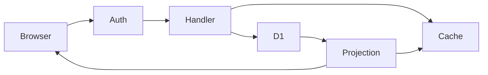

## Executive summary

This scoped model covers the new customer aggregate report. Principal risks are exposing paid trade instructions through an expanded audience, allowing analysts to bypass their private workspace scope, and multiplying historical report reads. The implementation uses a separate authenticated aggregate endpoint, an explicit numeric projection, unchanged staff endpoints, bounded monthly inputs, and short-lived internal caching. It creates no trading, messaging or financial mutations.

## Scope and assumptions

- Runtime: React/TypeScript frontend, tRPC on Cloudflare Workers (Express locally), D1 and the internal Workers Cache API.
- The owner explicitly confirmed all signed-in customer accounts, including accounts without subscriptions, receive aggregate totals only; staff scopes remain private. The owner confirmed cumulative progress, UTC report periods, Palestine display times, an arithmetic-only money illustration, and up to five-minute freshness in this conversation. These confirmations resolve the skill's context-validation questions; no repeat approval is needed.
- Existing account blocks, sessions, terms and survey UI gates remain. Anonymous public publication and broker execution are outside scope.
- Production exports for QA are private, ignored, read-only, and never placed in public build assets. Existing authentication activity bookkeeping may still occur on normal signed-in requests; the report introduces no business-data writes.
- Open question: traffic distribution and cache eviction affect cold-miss cost; measure locally and do not assume globally shared caching.

## System model
### Primary components

`frontend/src/pages/RecommendationPerformance.tsx` requests one month from `recommendations.customerPerformance` in `backend/routers.ts`. `backend/db.ts` reuses the staff parser and report calculation, then `backend/services/recommendation-performance.service.ts` builds an allowlisted aggregate. Existing staff publishing/report endpoints remain authoritative and scoped.

### Data flows and trust boundaries

- Browser → tRPC over HTTPS: session cookie, month, viewer ID. Existing context validates session/account state; protectedProcedure enforces terms; strict input schema validates month and rejects extra selectors. Viewer ID must match authenticated identity.
- Authorized handler → internal cache: only sanitized aggregate data, keyed by origin, month and algorithm version. Account/role authorization runs before lookup. Neither cookies nor RPC envelopes are stored. Browser query identity includes viewer ID.
- Cache miss → D1 through bound Drizzle queries: retained message history is parsed internally. No report mutation or provider call occurs. Staff data does not cross the projection boundary.
- Aggregate → browser: numeric summaries, dates, basis/freshness metadata only. RPC responses retain private/no-store headers. UTC buckets and separately formatted Palestine timestamps preserve report semantics.
- Private PRD export → local QA: ignored output directory only, no public assets or credentials. Build packaging does not include this directory.

#### Diagram

## Assets and security objectives

| Asset | Why it matters | Security objective (C/I/A) |
| --- | --- | --- |
| Live instructions and author metadata | Paid/private staff and customer data | C |
| Historical score integrity | Consistent daily, weekly and monthly reporting | I |
| Sessions and account restrictions | Limit report to authorized identities | C/I |
| D1 and Worker capacity | Avoid unnecessary historical reads per visitor | A |
| QA exports | May contain original staff-authored messages | C |

## Attacker model
### Capabilities

Anonymous visitors can call RPC URLs. Signed-in customers can alter inputs, repeat requests, and inspect every response. An analyst may try the customer endpoint to view cross-analyst totals.

### Non-capabilities

No assumed ability to modify Worker code, D1, protected internal cache entries, or another user's valid signed session. This feature does not connect to brokerage accounts or execute trades.

## Entry points and attack surfaces

| Surface | How reached | Trust boundary | Notes | Evidence (repo path / symbol) |
| --- | --- | --- | --- | --- |
| Aggregate RPC | customerPerformance query | Internet/API | Auth and strict month/viewer validation | backend/routers.ts / customerPerformance |
| Browser cache | Account change/remount | Identity/browser state | Viewer-scoped query key; no previous-month placeholder | frontend/src/pages/RecommendationPerformance.tsx |
| Server cache | Authorized read | Handler/cache | Explicit expiry, bounded memory, origin/version keys | backend/services/recommendation-performance.service.ts / createPerformanceCache |
| Illustration inputs | Numeric form fields | Browser/calculation | Finite arithmetic, no persistence | shared/recommendationPerformance.ts / illustratePerformance |
| Private exports | Wrangler read-only execute | PRD/local | Ignored filesystem only | output/recommendation-performance/ |

## Top abuse paths

1. Anonymous caller requests a populated cached month → protected middleware denies before lookup → no anonymous aggregate response.
2. Customer supplies a foreign viewer or analyst selector → identity comparison/strict schema rejects → no scope escalation.
3. Analyst enters customer URL to bypass own-work scope → staff/analyst check denies before cache → existing private report remains their route.
4. Developer accidentally spreads a staff report into a response → explicit summary projection and privacy tests prevent message/identity leakage.
5. Customer repeatedly refreshes or changes views → client switches reuse one payload; server cache reuses computation; arbitrary months rejected → reduced D1 amplification, though distributed misses remain possible.
6. Old cache snapshot is treated as fresh on remount → absolute expiresAt controls browser freshness and server checks → no stacked five-minute TTLs.
7. QA export is placed under public build directory → ignored private output and packaging checks prevent disclosure → source messages remain local.

## Threat model table

| Threat ID | Threat source | Prerequisites | Threat action | Impact | Impacted assets | Existing controls (evidence) | Gaps | Recommended mitigations | Detection ideas | Likelihood | Impact severity | Priority |
| --- | --- | --- | --- | --- | --- | --- | --- | --- | --- | --- | --- | --- |
| TM-001 | Anonymous/customer | RPC access | Read raw staff report through customer route | Paid/private data disclosure | Instructions, authors | protectedProcedure; explicit projection | Future fields could drift | Assert exact output keys and anonymous denial | Focused route/privacy tests | low: explicit boundary | high: instructions/private identity | medium |
| TM-002 | Analyst | Signed-in staff | Use global customer cache to bypass own scope | Cross-manager disclosure | Analyst isolation | Staff and analyst checks before cache; existing staff endpoint untouched | Role/flag inconsistencies must be covered | Test analyst role without staff flag | Role matrix regressions | low: both checks | high: scoped data | medium |
| TM-003 | Customer | Authenticated access | Trigger many historical calculations | Capacity exhaustion | Worker/D1 | Bounded inputs/cache/month payload | Cache is per data center, misses can overlap across isolates | Benchmark cold misses; cap retained entries; coalesce local concurrent requests | Query-count and burst rehearsal | medium: repeated reads possible | medium: bounded feature cost | medium |
| TM-004 | Cache/lifecycle error | Previously cached report | Extend stale totals or reuse wrong identity | Misleading results | Score integrity | Absolute five-minute expiry; viewer key; failure labeling | No cross-data-center immediate invalidation | Do not promise immediate customer correction refresh | Fake-clock/identity/browser tests | low: expiry tested | medium: incorrect presentation | low |
| TM-005 | QA/build operator | Authorized private export | Publish raw fixture data or credentials | Private history disclosure | QA exports | Ignored output; no export in public source | Packaging discipline required | Verify ignored paths and build inputs | Diff/build checks | low: local QA only | high: staff data | medium |

## Criticality calibration

- Critical: session signing-secret disclosure; unauthenticated financial mutation. Neither surface is introduced here.
- High: disclosure of paid live instructions; a cross-manager private report bypass.
- Medium: repeated cold historical scans affecting capacity; persistent reporting errors caused by cumulative double counting.
- Low: a cosmetic date-label defect; an expired snapshot clearly marked pending manual refresh.

## Focus paths for security review

| Path | Why it matters | Related Threat IDs |
| --- | --- | --- |
| backend/routers.ts | Authentication, input and role boundary before cache | TM-001, TM-002, TM-003 |
| backend/services/recommendation-performance.service.ts | Projection, aggregation and internal cache | TM-001, TM-003, TM-004 |
| backend/db.ts | Preserve parser/history and staff scope | TM-001, TM-002 |
| frontend/src/pages/RecommendationPerformance.tsx | Identity, absolute freshness and arithmetic presentation | TM-004 |
| output/recommendation-performance/ | Private production evidence kept outside build | TM-005 |

## Notes on use

All new entry points and runtime trust boundaries are represented above. Local QA/export and production build/release are distinct from runtime. User-confirmed scope is incorporated. Security review and verification results are recorded in the feature document; benchmark findings remain environment-specific.
